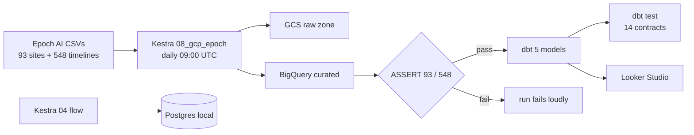

# Epoch AI Data Center Analytics – APAC Delivery Focus

Dashboard: https://datastudio.google.com/reporting/6192c6dc-90c3-45ae-990a-458f665d5557
Author: Ward (BINUS, AWS PM Intern APAC Data Center Delivery target)

## Problem
Where is AI capacity growing, how fast to build, and where should APAC delivery go next? The US dominates at ~12 GW while APAC tracks only 4 countries, and a delivery team cannot wait for a quarterly deck to decide where the next campus, grid connection and water contract should land.

This project turns the Epoch AI data center snapshot (93 sites, 548 timeline rows) into a decision surface with three concrete questions: which countries hold the power, how build speed has changed (2024 builds reached full power in ~900 days on average vs ~3,000 for 2019 starts), and which APAC market wins the next investment. The readable output is the delivery memo at the bottom: Johor (Malaysia, 895 MW today) vs Batam (Indonesia, 72 MW, closer to Singapore). Every figure in it is backed by a tested dbt model and a live dashboard tile.

## Source (not mine)
Epoch AI – AI Data Centers (CC-BY): https://epoch.ai/data/ai-data-centers
- `data_centers.csv` (93 sites), `data_center_timelines.csv` (548 rows, Oct 2026 snapshot)
- Accessed Oct 2026. Analysis mine.

## Architecture (batch, daily 09:00 UTC)
Kestra is the workflow orchestrator here (the Airflow equivalent in the course): it schedules the daily run, retries failed downloads, and versions the whole pipeline as YAML.
- Local path: Kestra `04_postgres_epoch` → Postgres `epoch` (tables data_centers_raw, data_center_timelines_raw). Zero cloud cost, good for trying the cleaning logic.
- GCP path: Kestra `08_gcp_epoch` → raw CSVs to GCS `gs://epoch-ai-data-lake-ward/raw/` → curated tables to BigQuery `epoch-ai-data-center.epoch_ai_dataset` (data_centers CLUSTER BY country,owner with no partitioning because a 93-row dimension gains nothing from it; timelines PARTITION BY date plus clustering because every mart filters by date; both are enforced on the load tasks themselves, so a fresh project comes out optimized from the first run, see ADR 0004) → row count ASSERTs (93 / 548, the run fails loudly on drift).
- Model: dbt (stg + mart_country_power + mart_yearly_power + mart_owner_power + mart_build_velocity, all covered by tests in `models/schema.yml`) → Looker

## Design decisions (ADRs)
Every non-obvious engineering choice is documented in [docs/adr](docs/adr/README.md) with its context, the honest downsides and the alternatives that were rejected. Highlights:
- [0003](docs/adr/0003-row-count-asserts-drift-gate.md): why the flow ASSERTs exact row counts, and why freshness lives in orchestration, not dbt.
- [0004](docs/adr/0004-unpartitioned-dimension-partitioned-series.md): why 93-row data_centers is deliberately unpartitioned while timelines is partitioned, and exactly which load properties implement it.
- [0005](docs/adr/0005-ndjson-load-and-kv-secrets.md): why NDJSON instead of CSV, and why credentials live in Kestra KV (OSS has no Secrets).
- [0006](docs/adr/0006-pinned-snapshot-and-rebasing.md): why the snapshot is pinned and what a rebase involves.

## Dashboard (2 required + 2 bonus)
1. Total Power by Country – AI Data Centers (bar, categorical)
2. Average Days from Groundbreaking to Full Power – AI Data Centers (line, temporal)
3. APAC Focus table + memo (Malaysia 895 MW, Indonesia 72 MW)
4. Map (bonus)

Tile design, verified numbers and refresh steps: [docs/dashboard.md](docs/dashboard.md).

## How to run
Prereqs: Terraform + gcloud auth, Docker, a Kestra server, dbt with the BigQuery adapter (`pip install dbt-bigquery`).

1. Provision: `terraform init && terraform apply` in the repo root (bucket + dataset, US).
2. Values: in Kestra open Namespaces → zoomcamp → KV Store and add `GCP_PROJECT_ID` (value `epoch-ai-data-center`) and `GCP_SERVICE_ACCOUNT` (paste the full service account JSON, never commit it). Both are read via `kv()` because namespace Secrets need Enterprise Edition. Flow 08 also takes `bucket`/`dataset` inputs (defaults match step 1).
3. Import `flows/04_postgres_epoch.yaml` (local path) and `flows/08_gcp_epoch.yaml` (GCP path) into Kestra, then Execute. Flow 08 uploads raw CSVs to GCS, loads curated newline-delimited JSON to BigQuery (immune to stray quotes and embedded newlines in source text), and ASSERTs row counts 93 / 548. A failed ASSERT means source drift, fix the column mapping before trusting the dashboard.
4. Local Postgres path: `docker compose up -d`, then run flow 04 (inputs default to host localhost, db epoch, user epoch).
5. dbt: copy `epoch_analytics/profiles.example.yml` into your dbt profiles as `epoch_analytics`, set `GOOGLE_APPLICATION_CREDENTIALS`, then `dbt run` (expect 5/5) and `dbt test` in `epoch_analytics`.
6. Open the Looker link.

## Cost (measured, not estimated)
All numbers from the actual runs of this project (BigQuery US on-demand pricing).

| Item | Measured usage | Cost |
|---|---|---|
| BigQuery load (NDJSON, 2 tables) | 2 load jobs | $0.00 (batch loads are free) |
| `dbt run` (5 views) | 0 bytes processed (`CREATE VIEW`) | $0.00 |
| Full dashboard load (all tiles) | ~21 KB scanned (measured: 1,315 + 19,543 bytes) | ~$0.0000001 |
| Storage (93 + 548 rows) | kilobytes | ~$0.00 |
| Kestra + Postgres | self-hosted Docker | $0.00 |
| **Total** | | **under $0.01 / month** |

The raw GCS zone could not be measured with the loader key: it has create-only permission by design (ADR 0005). At 93 + 548 rows it is bounded well under 1 MB either way.

## Quality gates
- `dbt test`: unique + not_null contracts on staging and every mart (see `models/schema.yml`). Source freshness is enforced in orchestration instead of dbt because the CSVs carry no ingest timestamp.
- Row count ASSERTs inside flow 08 catch source drift at load time and fail the run.
- CI (`.github/workflows/ci.yml`): Terraform fmt + validate and Kestra YAML syntax on every push.
- No committed state, keys, or build output (see `.gitignore`).

## Latest verified run (re-verified Oct 18, 2026)
- Kestra flow 08: success end to end, BigQuery counts 93 and 548 match the ASSERTs.
- dbt run: PASS 5 of 5. dbt test: PASS 14 of 14 (re-run Oct 18, 2026).
- Table optimization verified Oct 18, 2026: the load config (autodetect + partitioning + clustering) was replayed against a scratch dataset and produced timelines PARTITION BY date + CLUSTER BY data_center and data_centers CLUSTER BY country,owner with rows 93/548; live table metadata matches (ADR 0004).
- Dashboard tile scans measured for the cost table above (see `docs/dashboard.md`).
- CI: green on every push (see Actions tab).

## Known limitations
- Pinned snapshot: row counts, power figures, and the memo describe Oct 2026. Epoch updates will trip the ASSERTs first, then the numbers need rebasing (ADR 0006).
- Small data: 93 sites fit in memory. The transferable part is the practice (tests, monitoring, IaC), not the volume.
- The 04 Postgres path is a local dev alternative. CI covers Terraform and YAML only; dbt needs a live warehouse, so run `make dbt-test` before trusting changes.
- `force_destroy = true` is demo only. Never use it on a bucket you care about.
- data_centers is clustered but deliberately unpartitioned: partitioning a 93-row dimension adds cost without benefit (ADR 0004).
- IAM is manual: a fresh GCP project means creating the service account by hand (ADR 0002).

## Troubleshooting
Real issues hit while building this, and their fixes:
- Kestra says a secret is unavailable, or asks for Enterprise: namespace Secrets are Enterprise-only. Use the KV store + `kv()` instead (ADR 0005).
- Flow 08 fails at the ASSERT: that is the drift gate working. Epoch changed the source; fix the column mapping and rebase (ADR 0006) before touching the ASSERT numbers.
- `403 storage.objects.list` on the raw bucket: expected. The loader key can create objects but not list or read them (least privilege, ADR 0005).
- Table partitioning/clustering missing on a fresh dataset: the properties live on the BigQuery load tasks in flow 08 (`timePartitioningField`, `clusteringFields`). `WRITE_TRUNCATE` preserves whatever the table was created with, so fixing the flow only helps on the create path (ADR 0004).
- dbt cannot authenticate: set `GOOGLE_APPLICATION_CREDENTIALS` to the key JSON and give the service account BigQuery Data Editor + Job User.
- `terraform destroy` refuses to delete the bucket: it should, unless `force_destroy = true`. Empty the bucket first, or set the flag knowingly (demo only).
- CI is green but dbt was never run: true by design. CI validates Terraform and YAML only; run `make dbt-test` against a live warehouse before trusting changes.

## My decision (memo)
Malaysia leads APAC (Johor). Recommend Johor expansion + Batam next. Avg build 900 days (2024) vs 3000 (2019) – delivery faster now. Risk: grid + water.
